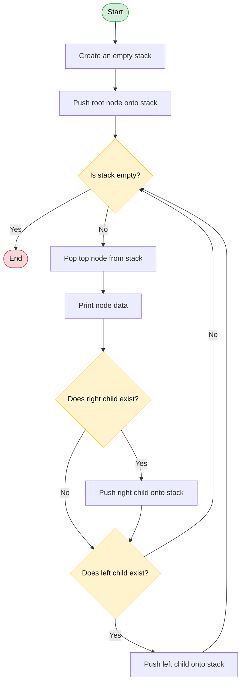

## 🔄 Flowchart

The following flowchart illustrates the non-recursive preorder traversal of a binary tree using a stack.



### Flowchart Explanation

1. **Start:** Begin the program.
2. **Initialize Stack:** Create an empty stack and push the root node.
3. **Check Stack:** If the stack is empty, terminate the traversal.
4. **Pop and Visit:** Pop the top node and print its data.
5. **Push Right Child:** If the right child exists, push it onto the stack.
6. **Push Left Child:** If the left child exists, push it onto the stack.
7. **Repeat:** Return to the stack check and continue until the stack is empty.

### Sample Output

```text
Preorder Traversal: 1 2 4 5 3
```

### Complexity Analysis

- **Time Complexity:** O(n)
- **Space Complexity:** O(n)

Here, `n` represents the total number of nodes in the binary tree.

**Note:** The right child is pushed before the left child because the stack follows the LIFO (Last In, First Out) principle. This ensures that nodes are visited in preorder: **Root → Left → Right**.
